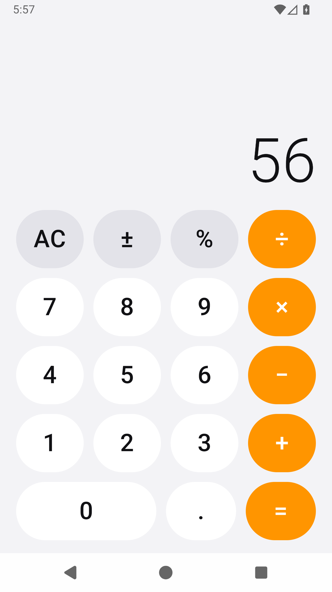
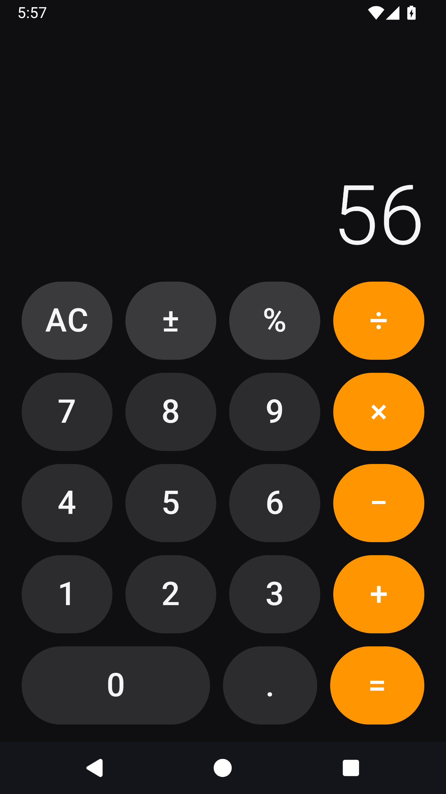

# Kotlin Calculator

A small, polished calculator for Android written in Kotlin with Jetpack Compose.
It is the Kotlin counterpart to the [swift-calculator](https://github.com/pagecow/swift-calculator)
iOS app: the same four-column keypad, the same nine-digit limit, and the same
"the engine is plain code, the UI is a thin shell" structure.

<p align="center">
  
  
</p>

## Features

- **Four operations** — add, subtract, multiply, divide, with chained input
  (`2 + 3 + 4 = 9`) and operation replacement (`5 + × 2 = 10`).
- **Calculator essentials** — AC, sign toggle, percent, decimal point, and a
  wide zero key.
- **Readable numbers** — thousands separators (`1,234,567`), eight decimal
  places, scientific notation for very large or very small results, and
  "Error" for division by zero.
- **A display that adapts** — long numbers shrink instead of clipping.
- **Light and dark themes** that follow the system, with a custom keypad
  palette and adaptive app icon.
- **Edge-to-edge layout** that respects system bars and cutouts.
- **State survives rotation** and dark-mode changes.
- **Haptic feedback** on every key press.
- **Screen-reader labels** for the function and operation keys.

## Project layout

| Path | Role |
| --- | --- |
| `app/src/main/java/com/example/kotlincalculator/calculator/CalculatorState.kt` | The calculator engine: an immutable, testable state machine with no Android imports |
| `app/src/main/java/com/example/kotlincalculator/ui/CalculatorScreen.kt` | Compose display + keypad, and the reusable `Key` button |
| `app/src/main/java/com/example/kotlincalculator/ui/theme/Theme.kt` | Material 3 light/dark color schemes |
| `app/src/main/java/com/example/kotlincalculator/MainActivity.kt` | Entry point; turns on edge-to-edge and sets the Compose content |
| `app/src/test/java/com/example/kotlincalculator/calculator/CalculatorStateTest.kt` | JVM unit tests for the engine |
| `app/src/main/res/` | Manifest resources, themes, and the adaptive launcher icon |

## Build and run

Requirements: JDK 17 and the Android SDK (platform 34, build-tools 34).
Gradle is pinned by the wrapper, so there is no global Gradle install to manage.

Point Gradle at your SDK by creating `local.properties` (not committed):

```properties
sdk.dir=/path/to/Android/sdk
```

Then:

```bash
# Build the debug APK
./gradlew :app:assembleDebug

# Run the engine's unit tests
./gradlew :app:testDebugUnitTest

# Install on a connected device or running emulator
./gradlew :app:installDebug
```

The APK lands at `app/build/outputs/apk/debug/app-debug.apk`.

You can also open the project in Android Studio and press Run.

## How it works

`CalculatorState` holds the value on screen, the digits currently being typed,
the left operand, and the pending operation. Each key calls a function that
returns a new state:

```kotlin
fun input(digit: Int): CalculatorState
fun decimal(): CalculatorState
fun toggleSign(): CalculatorState
fun percent(): CalculatorState
fun setOperation(operation: Operation): CalculatorState
fun evaluate(): CalculatorState
fun clear(): CalculatorState
```

Because there is no Android code in the engine, every one of those transitions
is covered by fast JVM tests — no emulator required. The Compose screen keeps
the state in `rememberSaveable`, so it is restored after a rotation, and renders
the display and keypad from that single object.
